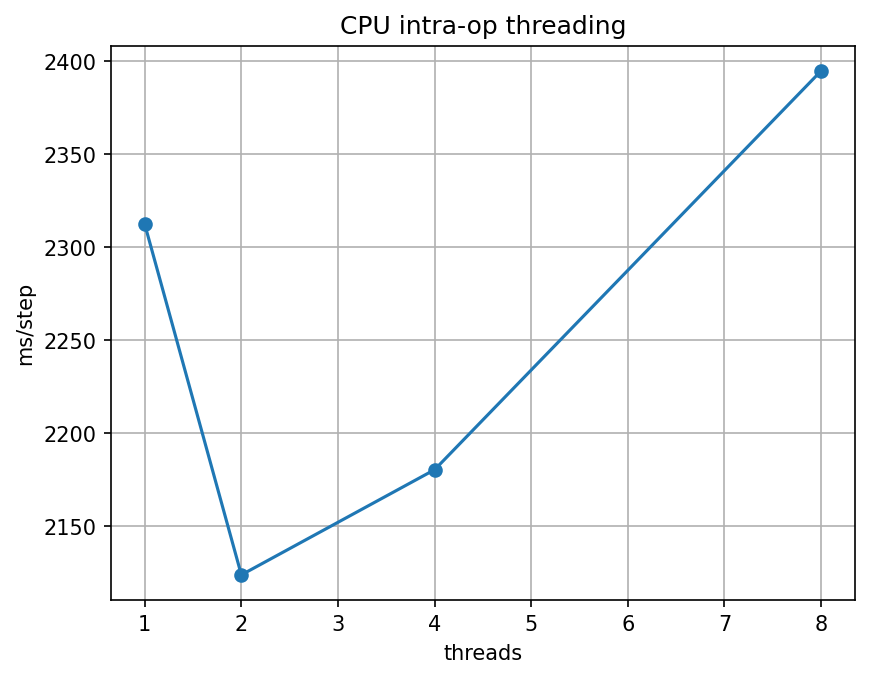

# Phase 2 — Reflection: where does parallelism stop helping?

Copy this file to `submission/phase2_reflection.md`, fill in every answer slot, and commit it:

```bash
cp phase-2-tiny-gpt/reflection_template.md submission/phase2_reflection.md
```

**How to fill it in.** Each answer sits between a pair of `<!--answer:...-->` markers. Replace
the `TODO` line with your answer — **leave the markers themselves untouched**, they are how the
grader finds your answers. Anything you write outside the markers is ignored, so add extra
prose, tables or your threading plot freely.

Numbers in section 1 must **match `submission/phase2_report.json`** — copy them across, do not
retype from memory; they are checked against it.

---

## 1. Your measurements

| | Value |
|---|---|
| Naive attention, ms (`attention.naive_ms`) | <!--answer:attn_naive_ms-->241.019<!--/answer--> |
| Vectorized attention, ms (`attention.vectorized_ms`) | <!--answer:attn_vectorized_ms-->1.034<!--/answer--> |
| CPU training, ms for 100 steps (`devices.cpu_ms`) | <!--answer:cpu_ms-->441705.8<!--/answer--> |
| GPU training, ms for 100 steps (`devices.gpu_ms`) | <!--answer:gpu_ms-->12770.8<!--/answer--> |
| Final training loss (`training.final_loss`) | <!--answer:final_loss-->1.4638<!--/answer--> |

**The thread sweep.** Give your four timings from `threads` — 1, 2, 4 and 8 threads — and say
which count was fastest. (verbatim: the numbers, in order)

<!--answer:thread_sweep-->
2312.243, 2123.852, 2180.355, 2394.618 ms for 1, 2, 4 and 8 threads. The fastest was 2 threads at 2123.852 ms.
<!--/answer-->

---

## 2. Intra-node parallelism, three ways

**Why vectorizing wins.** Both attention implementations do the same arithmetic and produce the
same result (the unit test checks that). Explain where the naive version's time actually goes,
and what the vectorized one does differently — in terms of the machine, not the Python.
(~70 words)

<!--answer:vectorization_why-->
The naive version performs 65,536 separate dot products for the scores and another 65,536 vector updates for the output. Almost all of its 241.019 ms goes to interpreter overhead, because every iteration means bytecode dispatch, temporary objects and a small NumPy call that touches only 64 floats. The vectorized version instead issues two matrix multiplies to OpenBLAS, which uses AVX-512 and FMA SIMD instructions, cache blocking and contiguous memory to process many floats per instruction. It finishes in 1.034 ms, 233 times faster.
<!--/answer-->

**Where the thread curve flattens, and why.** Using your sweep: more threads stopped helping —
or started hurting — at some point. Say where, and give the reason. Your Colab runtime's vCPU
count is part of the answer; so is what the threads have to coordinate on. (~80 words)

<!--answer:threading_plateau-->
The curve bottoms out at 2 threads with 2123.852 ms, only 8% less time than the 2312.243 ms at 1 thread, and rises again at 4 threads (2180.355 ms) and 8 threads (2394.618 ms). According to lscpu, the runtime's 2 vCPUs are one physical core with two hyperthreads, so the second thread only fills idle issue slots while both share the same vector units and caches. Beyond 2, the threads outnumber the hardware contexts. The OS has to time-slice them, and every operator pays extra work-splitting and synchronisation at each barrier without gaining any compute.
<!--/answer-->

**What made the GPU faster.** The model, the data and the step count were identical; only the
device changed. Say what about a transformer training step suits a GPU, and name one workload
that would *not* see this speed-up. (~70 words)

<!--answer:gpu_why-->
A training step is dominated by dense matrix multiplies in the attention projections, the MLP and the output head, all over 32 x 256 tokens. That is millions of independent multiply-adds, which the T4's 2,560 CUDA cores execute in SIMT lockstep with far higher memory bandwidth than the CPU. This cut 100 steps from 441705.8 ms to 12770.8 ms, a 34.6x speedup. Generating text one token at a time with a batch size of 1 would not benefit, since the work is sequential and too small to fill the GPU, so kernel-launch overhead would dominate.
<!--/answer-->

---

## 3. The question

**Where does parallelism stop helping, and why?** Pull the three experiments together. Your
answer should distinguish the *kinds* of limit you met — work that cannot be divided, hardware
you do not have, coordination that costs more than it saves, data that has to move — and say
which one bound each experiment. One concrete number from section 1 per claim. (~150 words)

<!--answer:parallelism_limit-->
Each experiment stopped at a different kind of limit. Vectorization removed work that was only serial because of how it was written. The Python loop executes one dot product at a time, and handing whole matrices to SIMD BLAS cut 241.019 ms down to 1.034 ms. Threading then ran into hardware I do not have. With a single physical core, the best result was 2123.852 ms at 2 threads, and beyond that the coordination cost more than it saved, rising to 2394.618 ms at 8 threads. The GPU removed the compute bottleneck, bringing 441705.8 ms down to 12770.8 ms, but it then ran into data movement and host work that cannot be divided. Every step builds its batch in a Python loop on the CPU, copies it from host to device and launches many small kernels, so the T4 only sustains about 1.9 TFLOP/s of its 8.1 TFLOP/s FP32 peak. This is Amdahl's law in practice, because once the parallel part is fast, the serial and transfer fraction sets the ceiling.
<!--/answer-->

**What you would measure next.** One experiment this phase did not run that would sharpen the
answer, and what result would change your mind. (~50 words)

<!--answer:next_experiment-->
I would sweep the GPU batch size from 8 to 256 and record the time per token. If throughput keeps rising almost linearly, then per-step overhead from batch construction, host-to-device copies and kernel launches is what starves the T4. If it flattens early, the GPU is genuinely compute-bound and my data-movement explanation is wrong.
<!--/answer-->


---

## Supporting evidence

**Threading sweep.** Section 3 of the notebook, timing one forward and backward step at batch 16.



**Colab CPU topology.** Running lscpu in the notebook showed 2 logical CPUs on an Intel Xeon CPU @ 2.00GHz, with
1 socket, 1 core per socket and 2 threads per core. PyTorch's default intra-op thread count on this runtime was 1,
so the 100-step CPU baseline in section 4 ran single-threaded.

**GPU utilisation estimate.** One training step is roughly 6 x 4,935,680 parameters x 8,192 tokens, or about
2.4 x 10^11 floating-point operations. At 12770.8 ms per 100 steps (127.7 ms per step) that works out to about
1.9 TFLOP/s, roughly a quarter of the T4's 8.1 TFLOP/s FP32 peak.

**Training.** Loss fell from 5.6972 at step 0, close to ln 256 = 5.545 for a uniform guess over 256 bytes, to a
final 1.4638 after 2,000 steps on the T4, and it was still slowly decreasing.
